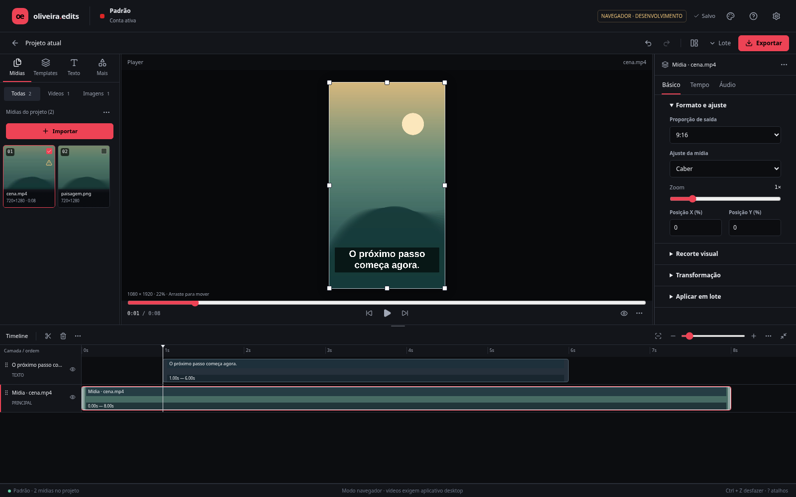

# Oliveira Edits 0.6.0 — editor mais simples

A biblioteca fica à esquerda, o player ganha espaço no centro e a timeline ocupa
a base inteira. O painel lateral mostra os ajustes da seleção em **Básico, Tempo
e Áudio**, em vez de exibir todas as ferramentas ao mesmo tempo.

## Onde estão as ferramentas

| Ação | Caminho |
| --- | --- |
| Importar arquivos | Mídias → Importar |
| Importar pasta inteira | Mídias → … → Importar pasta; também disponível no player vazio |
| Ordenar/selecionar os slots | Mídias → … |
| Começar uma nova leva | Mídias → … → Limpar todas, com confirmação e desfazer |
| Borda, marca, headline e fundo | Templates → categoria |
| Editar/adicionar outra camada/excluir template | … no cartão do template |
| Texto novo | Texto → Adicionar texto |
| Fontes e presets | Mais, na biblioteca |
| Enquadramento e alças | Selecione a mídia principal → Básico |
| Tamanho/posição de cada camada | Selecione a camada → Básico |
| Início e duração | Selecione o clipe → Tempo |
| Fim preciso, ponto de entrada e repetição | Tempo → Ajuste preciso |
| Aparar o arquivo original | Selecione o principal → Tempo → Aparar arquivo original |
| Áudio individual de vídeo | Selecione o vídeo → Áudio |
| Quadro exportado de uma imagem | Tempo → Quadro exportado |
| Dividir, duplicar, subir/descer ou remover camada | Botão direito na faixa ou … na barra da timeline |
| Fundo sólido padrão | Menu da timeline → Editar fundo / Mostrar fundo sólido |
| Assistente de recorte/cobertura e edição em massa | Lote, no topo |
| Aplicar a abertura aos outros arquivos | Lote → Aplicar sequência em massa |
| Player central, à direita ou foco | Ícone de visualização no topo |
| Informações e revinculação | … no inspetor → Informações do arquivo |

Os ajustes avançados começam recolhidos. A timeline se ajusta à janela ao abrir;
zoom, espaço extra e expansão continuam disponíveis. Arraste a divisória acima
dela para escolher quanto espaço dedicar ao player. As divisórias laterais
funcionam nos layouts central e à direita.

A biblioteca lembra a categoria escolhida e a rolagem dos slots ao alternar
recursos. Clicar em um slot seleciona sua mídia principal. Depois de desfazer
a criação de uma camada, a seleção volta ao principal. Dentro do editor,
Delete/Ctrl+D/S seguem a camada selecionada; uma divisão indisponível não recai
sobre o vídeo principal. Campos de texto mantêm suas teclas normais.

## Funcionalidades preservadas

Headlines podem durar mais que o vídeo ou foto. **Tempo → Usar como abertura**
coloca a mídia depois da chamada. As camadas mantêm tempos, ordem, dimensões e
áudio independentes, e o lote conserva os arquivos dos destinos. Vídeos são
exportados pelo desktop; fotos continuam PNG/JPG/WebP no quadro escolhido.

Foto do perfil, frases, temas, cores, fontes, ajustes com o mouse, recorte
inteligente, análise de marca, backup e desfazer/refazer permanecem disponíveis.
O assistente carrega ao ser aberto, reduzindo o JavaScript inicial. Templates em
vídeo usam miniaturas estáticas geradas sob demanda, sem um player ativo por cartão. Não houve
mudança de esquema, de dependências nem do motor de exportação nesta versão.

## Validação e atualização

Passaram 129 testes frontend/dados, 42 Rust, TypeScript/Vite, lint, formatação,
limite de 300 linhas por arquivo e build CLI Tauri Linux. Fluxos reais cobrem
501 arquivos com um único seletor, limpeza, temas/fontes/layouts, camadas,
sequências, PNG, backup, migração, OCR e referência visual.

A interface foi medida de 1100×700 a 1920×1080. Uma rodada de produção WebKit
Linux importou templates e exportou MP4/PNG pela interface, verificando frames
e uma abertura de 3s antes de um meme de 1s. Repetições também apresentaram
quedas do processo nativo do WebKit, inclusive com um único vídeo antes dos
templates; não foi comprovada a resolução dessa instabilidade neste ambiente.
Os resultados das tentativas são preservados, sem tratá-los como validação de
Windows. Evidências:
[resumo](validation/workspace-summary-2026-10-18.json),
[workspace](validation/workspace-ui-2026-10-18.json) e
[desktop](validation/workspace-native-2026-10-18.json).

Baixe `refactor/v2`, extraia em uma pasta nova e execute `npm ci`. Para gerar o
instalador, siga os comandos Windows do [README](../README.md); o aplicativo já
instalado só recebe a interface nova depois da recompilação e instalação.
Preserve seus perfis e backups. **NSIS e WebView2 ainda precisam de execução em
Windows**: a validação desta nuvem usa Linux e renderização em software.
